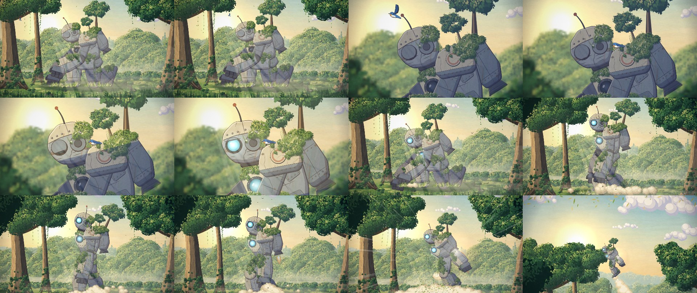

# moss-giant

[](https://github.com/oh-namgyu/moss-giant/actions/workflows/ci.yml)
[](LICENSE)

> **한글 요약** — 이미지·영상·음성 생성 모델 없이, AI 코딩 에이전트가 쓴 코드만으로 그림·움직임·소리를 만든 10초 2D 애니메이션과 그 제작 방식입니다. 배경 붓칠, 셀 로봇, 컷 연출, 소리 합성, MP4 굽기까지 전부 코드이고, 에이전트에게 지시하고 프레임을 검수한 절차와 실측 비용도 함께 공개합니다. 극장판 수준은 아니며, 프롬프트 한 번이 아니라 여러 차례 고쳐 얻은 결과입니다.

A 10-second 2D animation painted, animated and scored entirely by code an AI agent wrote, plus the method for making your own.


**[Watch it render live in your browser](https://oh-namgyu.github.io/moss-giant/)** · **[Download the MP4 with sound](https://github.com/oh-namgyu/moss-giant/releases/latest/download/moss-giant.mp4)**

## What it is

A moss-covered giant robot kneels in a forest at sunrise. A bird lands on its shoulder, light reaches its face, and it stands up and flies into the sky.

No image, video or audio model was used, and the repository contains no artwork or audio files for the film. Every leaf, ink line and sound comes from about 3,900 lines of JavaScript. The result ships two ways:

| Output | Size | How it plays |
|---|---|---|
| `dist/moss-giant.html` | about 114 KB | Computes every picture and sound live in the browser |
| `out/moss-giant.mp4` | about 15 MB | 1920×1080, 24 fps, 10 seconds, with sound |



## The method

The film works because it copies how an animation studio divides labour, not because any single technique is clever.

1. **Painted plates, separate from the character.** Five background plates are painted once, then moved at different speeds to create depth.
2. **Hand-made marks.** Thousands of small dabs and strokes go down in three to five tones, and a Kuwahara filter merges them into one painted surface.
3. **One rig, drawn fresh.** A single jointed robot stays on model in every shot. Its outlines change weight with pressure and wobble slightly from drawing to drawing.
4. **Animation timing.** The camera moves every frame, while drawings change at most 12 times a second.
5. **An agent that looks at its own work.** Each pass renders a contact sheet, the agent studies it, and the next pass fixes what it saw.

Read **[docs/METHOD.md](docs/METHOD.md)** for each technique with its source file. Read **[docs/AGENT-BRIEF.md](docs/AGENT-BRIEF.md)** for a brief you can hand to an agent to make a different film the same way.

## Quick start

Requires Node 20 or newer. `ffmpeg` is needed only for the MP4.

```sh
git clone https://github.com/oh-namgyu/moss-giant.git
cd moss-giant
npm ci
npx playwright install chromium

npm run build                     # dist/moss-giant.html: open it in a browser
npm run sheet                     # out/sheet.jpg: 24 frames on one image
npm run still -- 112 172          # out/f112.jpg, out/f172.jpg: full-size frames
npm run render                    # out/moss-giant.mp4 (set FFMPEG to choose the binary)
npm test                          # checks the claims in this README
```

## What it cost

Measured from the session log of the run that made the film. Publishing work such as these docs is not included.

| | |
|---|---|
| Wall-clock time | 41 minutes |
| Model | Claude Opus 5.5 in Claude Code, 31 responses |
| Output tokens | 163,172 |
| Cache read / cache write tokens | 7,330,201 / 205,276 |
| Cost at API list price | about $6.40 |
| Full renders | 4, taking 8.5 minutes in total |

If you are on a subscription, this comes out of your usage limit rather than appearing as a charge. Re-rendering the finished film uses no AI at all.

## Limits

- **It is not theatrical quality.** It reads as a charming storybook short. Limbs are rigid parts rotating at joints, so some movement is still puppet-like.
- **It was not one prompt.** The agent went through several visual passes, listed in the brief.
- **Nobody has judged the sound by ear during generation.** The agent could only measure levels and timing.
- **Determinism has edges.** In one browser build, a frame number always gives the same picture, and the tests enforce this. Other browsers may rasterize slightly differently, and the audio render is not bit-identical between runs.
- **Live playback depends on the machine.** One accelerated desktop Chrome measured about 15 frames per second. Without graphics acceleration it drops to about 5 at desktop size, and it has not been tried on a physical phone. The MP4 is the reliable way to watch.

## Prior art

The idea to try this came from [The Moss Keeper](https://chetaslua.github.io/moss-keeper/) by chetaslua, a short film that circulated as a demonstration of what coding models can do with animation. Moss Giant shares no code, frames or assets with it.

The Kuwahara filter is from Kuwahara et al., 1976. Limited animation timing, multiplane backgrounds and cel shading are long-standing animation craft.

## License

MIT — see [LICENSE](LICENSE). Security policy: [SECURITY.md](SECURITY.md).
