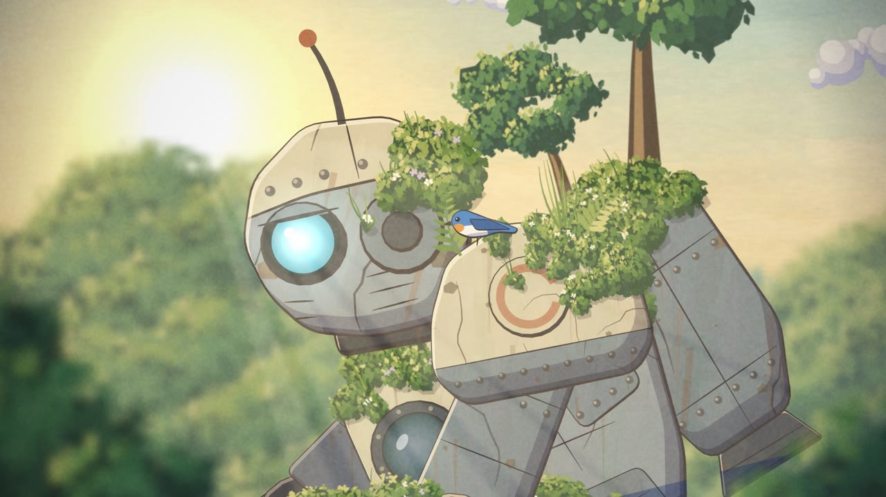

# The method

How the film gets its look, technique by technique. Paths are relative to `src/`.

The rule behind all of it: **do what an animation studio does, and let code be the hand.** Studios separate painted backgrounds from cel characters because the two need different treatment, so this code does too.

## 1. Plates: the painted world

Five plates are painted once when the page loads: sky, far ridges, forest, clearing and foreground grass (`scenery/`).

**Paint with marks, not shapes.** A tree is not a green circle. `foliage()` in `brush.js` lays a dark base, then scatters hundreds of small five-sided leaf dabs. Each dab picks one of five tones from where it sits relative to the light, plus some randomness. Lit tops and shaded undersides appear without anyone drawing them.

**Keep tonal zones coherent.** Too much randomness turns foliage into confetti. The `spread` option in `foliage()` controls this, and lowering it was one of the biggest visual gains.

**Melt the marks together.** A Kuwahara filter (`filters.js`) replaces each pixel with the mean of its calmest neighbouring quadrant. Edges stay and noise flattens, which looks like a loaded brush. A little low-frequency pigment noise then ties the plate together.

**Move plates at different speeds.** Each plate has a depth `d` (`drawLayer()` in `core.js`). Far plates barely move, foreground grass moves fastest, and that parallax creates the depth. In the close-up, a blurred copy of the forest plate stands in for shallow focus.

## 2. Cels: the character

The robot follows different rules from the plates: flat colour, hard shadows and ink lines.

**One rig, every shot.** `robot/pose.js` turns a small pose object into joint positions, solving the legs with two-bone inverse kinematics so feet stay planted while the body rises. Parts are drawn once in local coordinates (`robot/parts-*.js`). Reusing them is what keeps the character on model from any shot to any other.

**Shadows from geometry.** `drawPart()` in `robot/draw.js` gets its cel shading from a simple trick. Take a part's outline, shift a copy toward the light, and clip to the original: whatever the shifted copy misses is a crescent on the shadow side. Shift it the other way for a rim light. The light direction is converted into each part's local space every frame, so shadows stay correct as joints rotate.

**Ink with pressure.** `inkClosed()` in `robot/ink.js` draws an outline as a filled ring whose width varies along its length, heavier on the side away from the light.

**Line boil.** `wob()` nudges each outline point with noise keyed to the drawing number. The same drawing gets the same wobble, and the next drawing gets a slightly different one. This is why still shots feel alive.

**Age from physics.** `agedTex()` in `robot/weathering.js` paints rust so it runs downhill in the *kneeling* pose. `mossTex()` only grows moss where a surface faces up in that pose, then lets it spill past the outline to break the silhouette. Because the robot has been kneeling for a very long time, its dirt makes sense for that pose and looks subtly wrong once it stands, which suits the story.

## 3. Timing: why it feels like animation

Smooth motion is what makes code look like code. `renderFrame()` in `film/render.js` deliberately works against it:

- The **camera** moves on every frame, 24 times a second.
- **Drawings** change 12 times a second during action and 8 times a second in the slow opening.
- **Heavy moments** get anticipation before them. The robot dips before it rises and crouches before launch (`film/timeline.js`).
- **Impacts** get a camera shake that decays, and the launch stretches the body for a few frames as a smear.

## 4. Effects

All in `fx/`.

- **Smoke** is cel-shaded with hard-edged tones. It shrinks and breaks up as it dies rather than fading, the way drawn smoke does.
- **Particles** store only their start values. Position is a closed-form function of time, so any frame can be rendered alone, in any order, with no simulation to replay.
- **Grading** adds a little bloom, a warm-to-cool tint, a vignette and film grain, and it is the step that makes separate layers feel photographed together.

## 5. Sound

`audio/` builds the soundtrack with the Web Audio API: filtered noise for wind and rumble, oscillators for birds and a simple original melody, a band-passed sawtooth for the metal groan, and a generated reverb. One function renders live playback and the MP4 track through `OfflineAudioContext`.

The picture follows the audio clock during playback, so the two cannot drift apart.

## 6. One file, or a video

`tools/build.mjs` concatenates `src/` into a single HTML file with no bundler and no runtime dependencies. `tools/render.mjs` opens that same file in a headless browser, saves each frame and hands them to `ffmpeg`.

## Making your own

The reusable parts are `core.js`, `brush.js`, `filters.js`, `robot/ink.js`, the rig approach and the tools. The film-specific parts are `film/`, the part drawings and the plate compositions. To tell a different story, keep the first group and have an agent rewrite the second, following [AGENT-BRIEF.md](AGENT-BRIEF.md).
